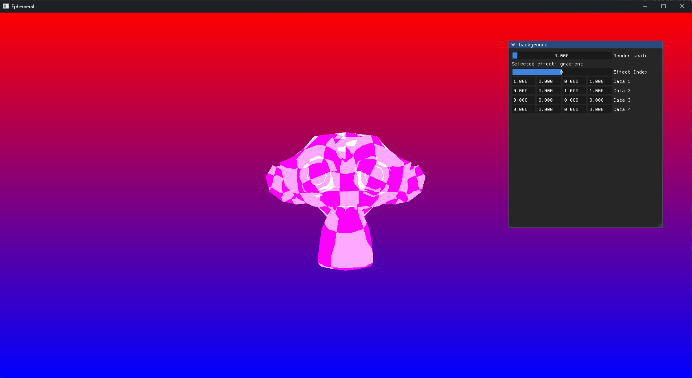

# Ephemeral: Simple Vulkan Renderer

API-decoupled Vulkan-based rendering engine(In active development).

## Screenshots

# Prerequisites

Ensure the following tools are installed and available in your system PATH:

- <a href="https://cmake.org/download/" target="_blank">CMake</a> (3.25+): Build system generator.

- <a href="https://git-scm.com/install/windows" target="_blank">Git</a>: Required for FetchContent dependency
  management.

- <a href="https://git-scm.com/install/windows" target="_blank">Doxygen (Doxywizard)</a> (Optional): Required to
  generate HTML/PDF documentation.

- <a href="https://releases.llvm.org/download.html" target="_blank">Clang-Format</a> : Required for automated code style
  enforcement.

## Getting Started

### Configuration

Initialize the build system and download dependencies. Bash

`cmake -B build`

### Compilation

Compile the entire project, including tests and benchmarks. Bash

`cmake --build build`

## Developer Utilities

Run these targets to maintain code quality and documentation.

- Auto-Format: `cmake --build build --target format`

- Generate Docs: cmake `--build build --target docs`

## Credits
- [VkGuide.dev](https://vkguide.dev/)
- [Khronos Vulkan Tutorial](https://docs.vulkan.org/tutorial/latest/00_Introduction.html)
